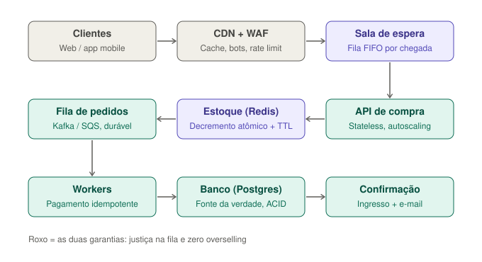

# Arquitetura de venda de ingressos (Rock in Rio)

Sistema para venda de ingressos de um show com demanda muito maior que o estoque.

## Requisitos

- Suportar picos enormes de acessos simultâneos.
- Nunca vender mais ingressos do que o estoque (zero overselling).
- Ser justo: quem tem internet lenta não perde a vez para quem tem internet rápida.

## Fluxo

1. **Clientes** acessam via web ou app.
2. **CDN + WAF** servem conteúdo estático em cache, filtram bots e aplicam rate limit, protegendo o backend.
3. **Sala de espera** (garantia de justiça): a posição na fila é definida no servidor pela hora de chegada. A velocidade da conexão na hora de clicar em comprar não muda a ordem. Os usuários são liberados em lotes, do tamanho que o backend aguenta.
4. **API de compra**: stateless, com autoscaling horizontal.
5. **Estoque no Redis** (garantia contra overselling): o decremento é atômico (script Lua). Se o resultado for `>= 0`, o usuário recebe uma reserva com TTL (ex.: 10 min). Se for `< 0`, vê "esgotado" na hora, sem tocar no banco. Reservas expiradas ou pagamentos que falham devolvem o ingresso ao estoque.
6. **Fila de pedidos** (Kafka/SQS): absorve picos e desacopla a API do pagamento.
7. **Workers** processam o pagamento com idempotência (chave por pedido), então um retry não cobra duas vezes.
8. **Postgres** é a fonte da verdade. Uma constraint única por ingresso impede venda dupla mesmo se o Redis falhar.
9. **Confirmação**: emissão do ingresso e envio de e-mail.

## Fora do escopo desta versão

Replicação do Redis e distribuição multi-região. Adicionar quando o SLA exigir.
